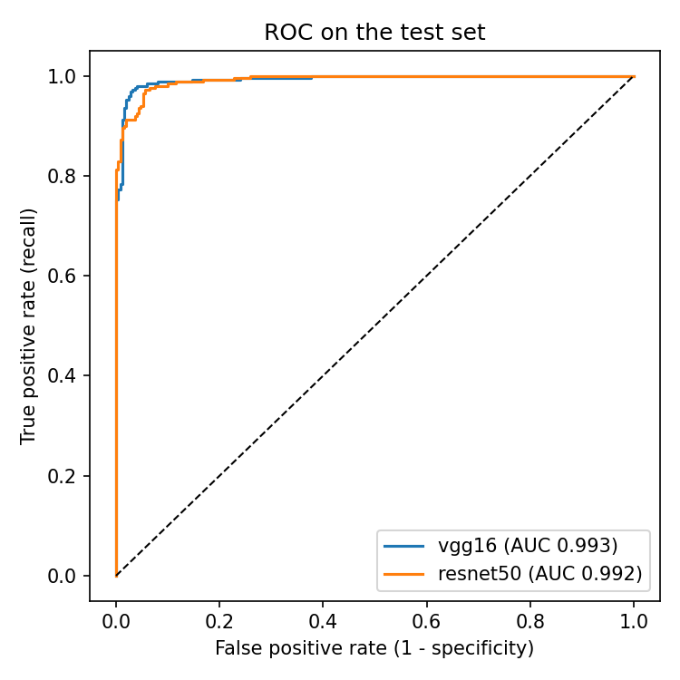
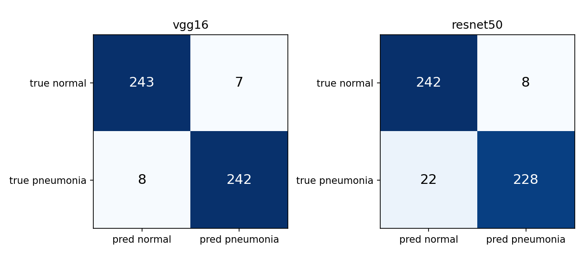
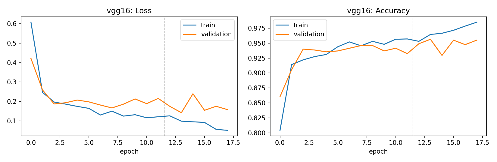
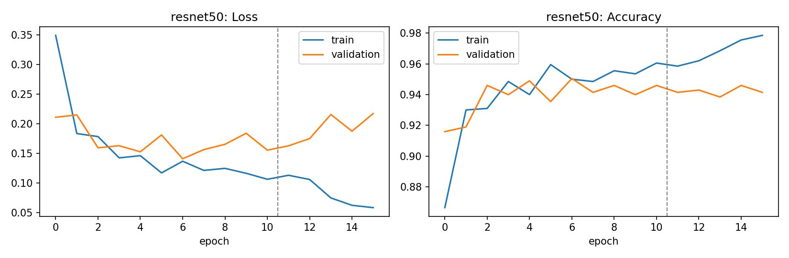

# Pneumonia detection from chest X-rays: VGG16 vs ResNet50

Transfer learning with Keras/TensorFlow on a balanced binary chest X-ray dataset (pneumonia vs normal). Both backbones are trained, tuned and evaluated with **the same pipeline**, and reported with the metrics that matter for a screening task (recall, specificity, ROC AUC, confusion matrix) and with patient-level confidence intervals.

> **Educational project. Not a medical device and not intended for clinical use.**

This repository is a cleaned-up, corrected rewrite of two earlier notebooks, kept in [`legacy/`](legacy/). Those notebooks were not comparable with each other and the ResNet one contained bugs. They are kept on purpose, and the problems are documented below in [Known issues in the original notebooks](#known-issues-in-the-original-notebooks).

## Results

Test set only (500 images, 250 per class, 359 patients), decision threshold 0.5. Format: value [95 % patient-level bootstrap CI].

| Model | Accuracy | Recall (pneumonia) | Specificity | Precision | F1 | ROC AUC | Missed pneumonia (FN) | False alarms (FP) |
|---|---|---|---|---|---|---|---|---|
| VGG16 | 0.970 [0.954, 0.984] | 0.968 [0.945, 0.988] | 0.972 [0.952, 0.991] | 0.972 [0.950, 0.990] | 0.970 [0.954, 0.984] | 0.993 [0.987, 0.998] | 8 / 250 | 7 / 250 |
| ResNet50 | 0.940 [0.915, 0.960] | 0.912 [0.871, 0.948] | 0.968 [0.944, 0.988] | 0.966 [0.939, 0.988] | 0.938 [0.910, 0.960] | 0.992 [0.986, 0.996] | 22 / 250 | 8 / 250 |




**What the numbers say**

- **Discrimination is the same.** ROC AUC is 0.993 vs 0.992: both networks rank pneumonia above normal equally well.
- **The difference is at the default threshold.** At 0.5, ResNet50 misses 22 pneumonia cases against 8 for VGG16 (recall 0.912 vs 0.968), with practically the same number of false alarms (8 vs 7). The recall intervals barely separate, and the intervals are computed per model, not as a paired comparison, so treat "VGG16 is better" as *probably* rather than *proven*. A different threshold would likely close most of the gap, since the AUC is equal.
- **Fine-tuning did not help ResNet50.** In phase 2 its best validation epoch was the first one, and validation loss then rose while training accuracy kept climbing. VGG16 gained slightly (best epoch 2 of phase 2) before overfitting as well. Both models would benefit from stronger regularisation or more data.
- **Test is easier than validation.** Both models score about 2 points higher on test than on validation (VGG16: ~95 % validation, 97 % test). With 666 and 500 images that is within the noise, but it is a reminder that one test split gives one estimate, not a guarantee.

Compared with the original notebooks: VGG16 accuracy is unchanged (97.0 % in both), so the rewrite did not make VGG16 better; what it added is recall, specificity, AUC, confidence intervals and a fair comparison. ResNet50 improved from 90.0 % to 94.0 % once the pipeline bugs were fixed.

### Learning curves

The dashed line marks the start of fine-tuning (phase 2).




### Error analysis

The most confident mistakes are plotted in [`results/vgg16_errors.png`](results/vgg16_errors.png) and [`results/resnet50_errors.png`](results/resnet50_errors.png). Observations from looking at them (I am not a radiologist, so these are hypotheses, not findings):

- Several of the worst misses are pneumonia cases predicted with P(pneumonia) ≈ 0.00, and the single worst miss is the same image for both models. That points to subtle cases or noisy labels rather than a model-specific weakness.
- Several ResNet50 misses are images with a different acquisition style (anteroposterior markings, ECG leads visible), which suggests some sensitivity to image style, not only to lung content.
- Many images carry side markers ("R") and text overlays. Without explainability maps there is no way to rule out that the models partly use these cues. See *Possible next steps*.

## Dataset

- 3,166 chest X-ray images, two classes: `neumonia` (pneumonia, bacterial and viral) and `normal`.
- Source: the chest X-ray part of *Labeled Optical Coherence Tomography (OCT) and Chest X-Ray Images for Classification* (Kermany et al., 2018, [Mendeley Data](https://data.mendeley.com/datasets/rscbjbr9sj/2); described in *Cell* 172(5):1122-1131). Files are named `(label)-(randomized patient ID)-(image number for that patient)`, which is what makes the patient-level audit below possible. Please cite the original authors and check the licence terms on the dataset page.
- The splits were rebuilt to be **balanced** (this differs from the original public split, so numbers are not comparable with other published results):

| Split | Pneumonia | Normal | Total |
|---|---|---|---|
| Train | 1,000 (500 bacterial, 500 viral) | 1,000 | 2,000 |
| Validation | 333 (150 bacterial, 183 viral) | 333 | 666 |
| Test | 250 (125 bacterial, 125 viral) | 250 | 500 |

### Split audit (patient leakage)

The same patient can contribute several images (`...-0001`, `...-0002`), so an image-level random split would leak patients across splits and inflate the metrics. Section 1.1 of the notebook audits this from the file names.

Findings on the original split:

- The splits occupy **contiguous, non-overlapping ID ranges** (for example, normal-class IDs run up to 6,357,850 in train, start at 6,367,802 in validation and at 8,423,585 in test), so the split is effectively patient-level.
- The numeric ID alone is *not* a unique patient key: the same number appears under different prefixes (for example `BACTERIA-` and `VIRUS-`). The audit therefore uses **prefix + ID**.
- Only one patient key is shared between train and test (`BACTERIA-1820776`, at the boundary of the ID ranges): one image on each side, out of 500 test images. Negligible, but reported.

## Method

| | |
|---|---|
| Input | 224×224 RGB for both backbones |
| Preprocessing | Each backbone's own `preprocess_input` |
| Augmentation (train only) | Small rotation (±7°), zoom (10 %), translation (5 %). **No horizontal flip** (chest anatomy is not mirror-symmetric) |
| Head | `GlobalAveragePooling2D → Dense(256, ReLU) → Dropout(0.5) → Dense(1, sigmoid)` |
| Phase 1 | Backbone frozen, train the head (Adam, lr 1e-3) |
| Phase 2 | Unfreeze only the last conv block (`block5*` for VGG16, `conv5_block*` for ResNet50; BatchNorm stays frozen), fine-tune (Adam, lr 1e-5) |
| Regularisation | `EarlyStopping` on validation loss (restore best weights), `ReduceLROnPlateau` |
| Class convention | `normal = 0`, `pneumonia = 1`, so the sigmoid output is **P(pneumonia)** and "recall" means pneumonia cases caught |
| Reproducibility | Fixed seed (42). GPU runs can still differ slightly between executions |

`unfreeze_last_block()` prints how many layers were actually unfrozen and **raises an error if none were**, a guard against the silent bug described below.

### Evaluation protocol

- The test set is used **once**, after all choices were made on the validation set, and is never shuffled. A sanity check asserts that the prediction order matches the labels read from the folder names.
- Metrics: accuracy, recall, specificity, precision, F1, ROC AUC, confusion matrix.
- Confidence intervals: **patient-level bootstrap** (1,000 resamples of patients, not images), so several images of one patient do not make the intervals look narrower than they are.
- Error analysis: the most confident mistakes of each model are plotted at the end of the notebook.

## Known issues in the original notebooks

The two original notebooks ([`legacy/RadiografiascnnVGG16.ipynb`](legacy/RadiografiascnnVGG16.ipynb) and [`legacy/RadiografiascnnResNet.ipynb`](legacy/RadiografiascnnResNet.ipynb)) were written as a first experiment. Reviewing them side by side showed that they cannot be compared, and that the ResNet one has real bugs. Their reported test accuracies (VGG16 **97.0 %**, ResNet50 **90.0 %**) should not be read as "VGG16 beats ResNet50".

### ResNet50 notebook

| # | Issue | Effect |
|---|---|---|
| 1 | **Intended fine-tuning never happened.** The code compares a layer name with a *list* (`layer.name == layer_to_unfreeze` where `layer_to_unfreeze = ['conv5_block3_3_conv']`), which is never true. | The whole backbone stayed frozen. `model.summary()` shows all 23.6 M ResNet parameters as non-trainable. Fix: `layer.name in layer_to_unfreeze`, plus an assertion that something was unfrozen. |
| 2 | **`EarlyStopping` was defined but never passed to `fit`** (`callbacks=` missing). | Dead code; no early stopping. |
| 3 | **Wrong preprocessing.** Images were scaled with `rescale=1/255`, but `ResNet50` expects `resnet50.preprocess_input` (ImageNet mean subtraction, BGR order). | With a frozen backbone the extracted features are off-distribution, which likely contributes to the lower accuracy. |
| 4 | `Flatten` head on a 7×7×2048 map: 100,352 → 256 dense units. | 25.7 M trainable parameters in the head alone, for 2,000 training images. |
| 5 | Training stopped while still improving (train 91.3 %, val 92.0 %, validation loss still decreasing at epoch 30). | The model was under-trained, the opposite of the VGG16 run. |

### VGG16 notebook

| # | Issue | Effect |
|---|---|---|
| 1 | **Only accuracy was reported.** No recall, specificity, precision, AUC or confusion matrix. | In pneumonia screening the costly error is a missed case, which accuracy alone hides. |
| 2 | Mild overfitting: train accuracy 99.6 % vs validation 95.0 %; validation loss reached its minimum around epoch 9 and then stalled. | 30 epochs with no early stopping and no augmentation. |
| 3 | Class order was alphabetical (`neumonia = 0`, `normal = 1`), so the sigmoid output is P(normal). | Not a bug, but easy to misread when computing recall. |
| 4 | `/255` instead of `vgg16.preprocess_input`. | Minor for VGG16, but inconsistent with how the backbone was trained. |
| 5 | Deprecated `fit_generator`; single test run with no confidence interval. | Maintenance and reporting. |

### Why the two runs were not comparable

| | VGG16 notebook | ResNet50 notebook |
|---|---|---|
| Input size | 150×150 | 224×224 |
| Backbone state | frozen (as intended) | frozen (by accident) |
| Preprocessing | `/255` | `/255` (should be `resnet50.preprocess_input`) |
| Trainable parameters | ~2 M | ~25.7 M |
| Early stopping | none | defined but unused |
| Metrics | accuracy | accuracy |

### What was changed in this version

- One pipeline for both backbones: same input size, own `preprocess_input`, same head, same two-phase schedule, same callbacks.
- Fine-tuning fixed, with an assertion that fails loudly if nothing is unfrozen.
- Global average pooling instead of `Flatten`.
- Light augmentation, early stopping and LR scheduling.
- Full metric suite and patient-level confidence intervals.
- Explicit patient-leakage audit of the splits.

## Limitations

- **Single source and population.** The images appear to be paediatric chest X-rays from a single published dataset (see *Dataset*). Results say nothing about adults, other scanners or other hospitals. External validation is the real test and has not been done.
- **Balanced test set.** Real-world prevalence is not 50/50, so precision (PPV) would be lower in practice at the same recall and specificity.
- **No clinical validation, no calibration analysis, no explainability yet.** The model should not be used for diagnosis.
- Small test set (500 images, ~360 patients): see the confidence intervals.

## How to run

1. Put `radiografias.zip` (folders `entrenamiento/`, `validacion/`, `test/`, each with `neumonia/` and `normal/`) in your Google Drive and adjust the paths in the configuration cell.
2. Open `pneumonia_xray_transfer_learning.ipynb` in Google Colab with a GPU runtime (a T4 is enough).
3. Run all cells. Models, training histories, figures and `results.csv` are saved to `OUT_DIR`.

Run in Google Colab (T4 GPU) with TensorFlow 2.21 / Keras 3.13. Also needs scikit-learn, pandas, matplotlib and Pillow (all preinstalled in Colab).

## Repository structure

```
.
├── README.md
├── pneumonia_xray_transfer_learning.ipynb   # main notebook (both models, same protocol)
├── legacy/
│   ├── RadiografiascnnVGG16.ipynb            # original VGG16 experiment (kept for reference)
│   └── RadiografiascnnResNet.ipynb           # original ResNet50 experiment (kept for reference)
└── results/                                  # figures and results.csv produced by the notebook
```

## Possible next steps

- Grad-CAM heatmaps to check that the models look at the lungs and not at markers, text overlays or borders.
- A paired comparison of the two models (paired bootstrap or McNemar) and a decision threshold chosen on the validation set for a target recall.
- Evaluation on an external chest X-ray dataset.
- Threshold selection for a target recall, with the resulting precision trade-off.
- Probability calibration and a bacterial-vs-viral subtype analysis.
